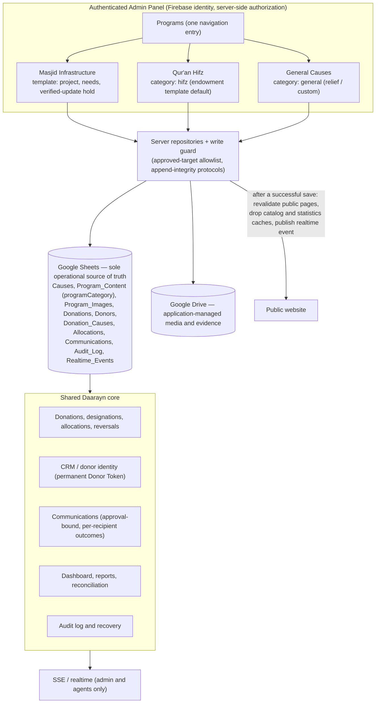
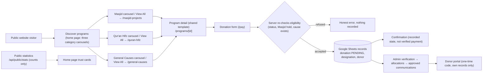

# Daarayn architecture diagrams (D19) — reflect the code as implemented on 2026-10-30

Rendered by any Mermaid viewer (GitHub, VS Code preview). Solid arrows exist in the code today; dashed arrows are owner-dependent and NOT operational yet (noted in the legend).

## 1. Admin architecture

Category, template, lifecycle, publication and eligibility are independent fields:
`programCategory` (masjid | hifz | general) is stored in `Program_Content` and chooses the admin experience and public listing; `template` (relief | endowment | project | custom) chooses the page sections; lifecycle status (Draft, Active, Urgent, Completed, Inactive) lives on the cause; only Active and Urgent are public; the donation service re-reads eligibility (and the Masjid hold) from Sheets on every request. The Masjid-only update hold applies to the project template only.

## 2. Public user architecture

Notes: carousels show the first 12 published programs of a category in the administrator's order; arrow clicks only scroll cards already loaded (no Sheets call); View All pages list every published program of the category. Public data is cached (30 s data cache, tag-revalidated on every admin save, bounded staleness 10 minutes); statistics are cached 30 s and refreshed by the open page every 60 s while visible. Dashed/owner-dependent items: public hosting on `daaraynorg.com`, Google OAuth production status, production worksheets (migration blocked).
